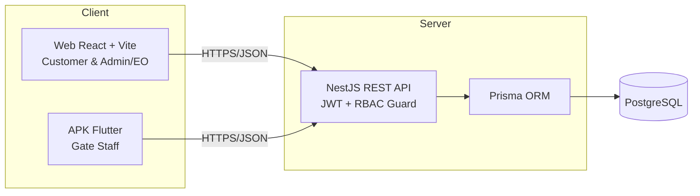
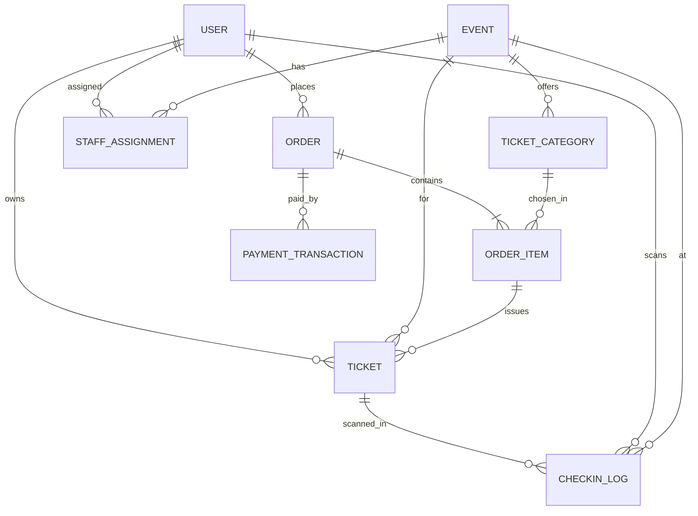
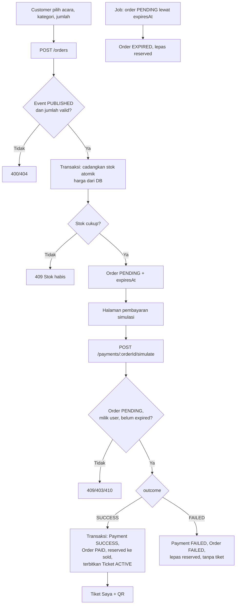
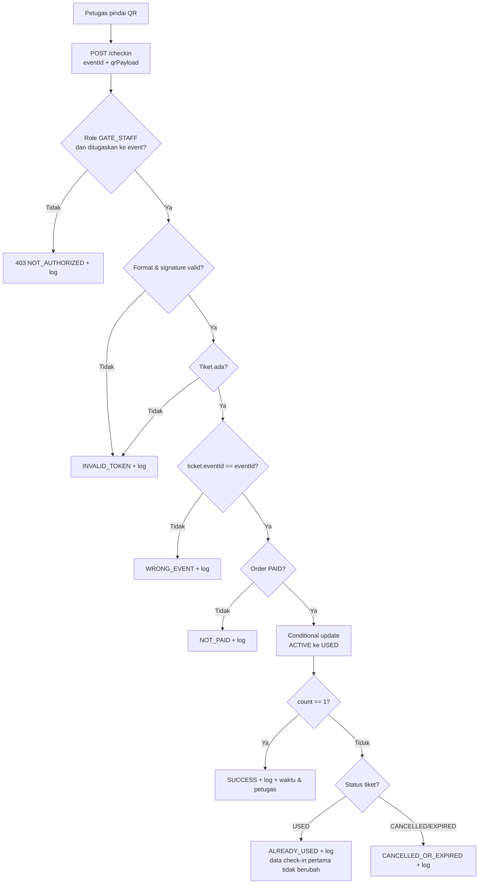

# CrowdPulse Ticketing: Tahap 1 (Perencanaan)

Status: **DISETUJUI** oleh pemilik proyek (7 poin konfirmasi disetujui semua).
Ruang lingkup: hanya sistem ticketing. Tidak ada crowd monitoring, ML, atau kamera monitoring.

## 1. Requirement

### Fungsional

| ID | Requirement | Komponen |
|---|---|---|
| FR-01 | Pengunjung melihat daftar acara, mencari, dan memfilter berdasarkan kategori atau tanggal | Web, API |
| FR-02 | Pengunjung melihat detail acara, kategori tiket, harga, dan ketersediaan | Web, API |
| FR-03 | Registrasi, login, logout, dan profil pengunjung | Web, API |
| FR-04 | Pengunjung membuat order (acara, kategori, jumlah) dengan status PENDING | Web, API |
| FR-05 | Harga dan stok ditentukan serta diverifikasi backend | API |
| FR-06 | Pembayaran simulasi (sukses atau gagal) dengan validasi transisi status | Web, API |
| FR-07 | Tiket terbit hanya setelah order PAID | API |
| FR-08 | "Tiket Saya" menampilkan QR, kode tiket, status bayar, status penggunaan, hanya milik sendiri | Web, API |
| FR-09 | Admin/EO mengelola acara, kategori, dan kuota | Web, API |
| FR-10 | Admin/EO melihat order, tiket, ringkasan penjualan dan check-in, serta mengelola akun petugas | Web, API |
| FR-11 | Admin/EO menugaskan petugas ke acara tertentu | Web, API |
| FR-12 | Petugas login di APK dan melihat acara yang ditugaskan | APK, API |
| FR-13 | Petugas memindai QR dan backend melakukan check-in atomik | APK, API |
| FR-14 | Semua percobaan scan (berhasil maupun ditolak) tercatat di riwayat check-in | API |
| FR-15 | Petugas melihat riwayat scan miliknya | APK, API |
| FR-16 | RBAC di backend: ADMIN, CUSTOMER, GATE_STAFF | API |

### Nonfungsional

| ID | Requirement |
|---|---|
| NFR-01 | Keamanan: hash password (Argon2), JWT berumur pendek, validasi DTO, rate limiting login dan check-in, CORS terbatas, tanpa rahasia di repo |
| NFR-02 | Integritas data: tidak ada overselling dan tidak ada check-in ganda, bahkan saat request bersamaan |
| NFR-03 | Konsistensi: operasi multi-tabel memakai transaksi database |
| NFR-04 | Performa: check-in p95 < 500 ms pada jaringan lokal (target awal, diukur di Tahap 6) |
| NFR-05 | Auditabilitas: setiap check-in dan transisi pembayaran tercatat |
| NFR-06 | Kegunaan: web responsif (mobile-first), APK menampilkan hasil scan jelas (hijau/merah) |
| NFR-07 | Keterujian: unit test dan e2e test, API terdokumentasi di Swagger |
| NFR-08 | Portabilitas: seluruh sistem berjalan lokal dengan Docker Compose (PostgreSQL) dan `.env` |
| NFR-09 | Fail-safe: jika server tidak terjangkau, APK tidak pernah mengizinkan masuk otomatis |

## 2. Arsitektur sistem



Lapisan backend: Controller (HTTP, validasi DTO), Service (logika bisnis), Prisma (akses data). Guard global: `JwtAuthGuard`, lalu `RolesGuard`. Pengecekan kepemilikan (ownership) dilakukan di service.

### Keputusan desain

**a. Reservasi stok.** Stok dicadangkan saat order dibuat (PENDING) dengan `expiresAt` (default 15 menit).
- Cadangan dilepas jika pembayaran gagal atau order kedaluwarsa (job terjadwal `@nestjs/schedule`).
- Pencadangan memakai satu pernyataan atomik: `UPDATE ... SET reservedCount = reservedCount + :qty WHERE id = :id AND soldCount + reservedCount + :qty <= quota`. Jika 0 baris terpengaruh, stok habis.

**b. Pembayaran simulasi.**
- `POST /payments/:orderId/simulate` hanya untuk CUSTOMER pemilik order.
- Aktif hanya jika `PAYMENT_SIMULATION_ENABLED=true`; jika `false` mengembalikan 404.
- Hanya order PENDING yang belum kedaluwarsa. Klien mengirim `outcome: SUCCESS | FAILED`, bukan status order.
- Semua percobaan tercatat di `PaymentTransaction`. UI berlabel "SIMULASI, bukan transaksi uang sungguhan".
- Idempoten: percobaan kedua pada order final ditolak dengan 409.

**c. QR Code.**
- Payload: `CP1.<ticketCode>.<signature>`; `ticketCode` acak 128-bit (base32); `signature = HMAC-SHA256(ticketCode, QR_SECRET)` dipotong.
- Tidak ada data pribadi di QR. Signature diverifikasi (constant-time) sebelum query database.
- `qrTokenHash` diganti HMAC agar tiket bisa ditampilkan ulang di "Tiket Saya". Kolom `qrVersion` disediakan untuk rotasi token.

**d. Check-in atomik.**
```
UPDATE tickets SET status='USED', checkedInAt=now(), checkedInById=:staff
WHERE id=:id AND status='ACTIVE' AND eventId=:eventId
```
Di Prisma: `updateMany` dengan kondisi tersebut. `count === 1` berarti sukses; jika 0, backend membaca tiket untuk menentukan alasan penolakan. Log check-in ditulis dalam transaksi yang sama.

**e. Penugasan petugas.** Tabel `StaffAssignment` (staff, event). Petugas tidak bisa check-in untuk acara yang tidak ditugaskan kepadanya.

## 3. ERD



Skema lengkap ada di `apps/backend/prisma/schema.prisma`.

### Perubahan dari skema minimal di prompt

| Perubahan | Alasan |
|---|---|
| Tabel baru `CheckInLog` | Audit: setiap scan, termasuk yang ditolak, tercatat. `ticketId` nullable karena token tak dikenal tidak punya tiket. |
| Tabel baru `StaffAssignment` | Mendukung "acara yang diizinkan" untuk petugas. |
| `TicketCategory.reservedCount` | Mendukung reservasi stok PENDING. Invarian `soldCount + reservedCount <= quota` (CHECK constraint). |
| `Order.expiresAt` | Batas waktu pembayaran dan pelepasan stok. |
| `Ticket.qrTokenHash` diganti `qrVersion` | Lihat 2c. |
| `Event.slug`, `Event.category`, `User.isActive` | URL ramah, filter kategori, penonaktifan akun petugas. |
| Harga integer (Rupiah) | Menghindari galat floating-point. |

### Enum
- `Role`: ADMIN, CUSTOMER, GATE_STAFF
- `EventStatus`: DRAFT, PUBLISHED, CANCELLED, FINISHED
- `OrderStatus`: PENDING, PAID, FAILED, EXPIRED, CANCELLED
- `PaymentStatus`: PENDING, SUCCESS, FAILED
- `TicketStatus`: ACTIVE, USED, CANCELLED, EXPIRED
- `CheckInResult`: SUCCESS, ALREADY_USED, INVALID_TOKEN, NOT_PAID, CANCELLED_OR_EXPIRED, WRONG_EVENT, NOT_AUTHORIZED

## 4. Flowchart

### Pembelian



### Check-in



Jika APK tidak bisa menghubungi server, APK menampilkan "Validasi belum dapat dilakukan. Coba lagi." dan tidak pernah meloloskan otomatis.

## 5. Daftar endpoint
Lihat `docs/api/endpoints.md`.

## 6. Struktur repository

```
crowdpulse/
├─ apps/
│  ├─ backend/    (NestJS: prisma/, src/, test/)
│  ├─ web/        (React + Vite + TS + Tailwind, Tahap 4)
│  └─ mobile/     (Flutter, Tahap 5)
├─ docs/ (architecture/, api/, testing/)
├─ docker/, scripts/
├─ docker-compose.yml
├─ .env.example
└─ README.md
```

URL API untuk APK dikonfigurasi lewat `--dart-define=API_BASE_URL=...`. Emulator Android memakai `http://10.0.2.2:3000`; HP fisik memakai IP LAN komputer (misalnya `http://192.168.x.x:3000`) pada Wi-Fi yang sama dengan firewall mengizinkan port tersebut.

## 7. Roadmap

| Tahap | Isi | Keluaran yang dapat diverifikasi |
|---|---|---|
| 1 | Perencanaan | Persetujuan (selesai) |
| 2 | Backend dasar: NestJS, Prisma, PostgreSQL, migration, seed, Auth/JWT/RBAC, test dasar | Login 3 role, RBAC teruji, Swagger aktif |
| 3 | Backend ticketing: event, kategori, order, pembayaran simulasi, tiket, check-in atomik, log, job expiry, test | Test concurrency lulus, alur API lengkap |
| 4 | Website: UI publik, auth, pembelian, pembayaran simulasi, Tiket Saya + QR, dashboard admin | Alur pembelian di browser |
| 5 | APK Flutter: login, acara, scanner, hasil, riwayat, build APK debug | Scan QR dari web ke APK |
| 6 | Integrasi dan E2E, uji keamanan dasar, performa, dokumentasi final | Tabel test case PASS/FAIL dengan bukti |

## 8. Strategi pengujian
Lihat `docs/testing/test-strategy.md`.

## 9. Risiko dan mitigasi

| Risiko | Dampak | Mitigasi |
|---|---|---|
| Check-in ganda saat dua petugas scan bersamaan | Tiket dipakai dua kali | Conditional update atomik; test concurrency |
| Overselling | Tiket melebihi kuota | Pencadangan atomik + CHECK constraint; test paralel |
| Stok tertahan order PENDING yang ditinggalkan | Stok terkunci | `expiresAt` + job pelepasan idempoten |
| Endpoint simulasi disalahgunakan | Order PAID tanpa kontrol | Feature flag, auth pemilik, validasi transisi, pencatatan |
| Harga dimanipulasi dari klien | Kerugian finansial | Harga hanya dari DB |
| QR dipalsukan atau ditebak | Akses tidak sah | ticketCode 128-bit + HMAC constant-time |
| QR di-screenshot dan dibagikan | Satu pemakaian sah, sisanya ditolak | Aturan sekali pakai atomik; QR dinamis di luar lingkup |
| IDOR (akses tiket/order orang lain) | Kebocoran data | Filter `ownerId`/`userId` di service + test negatif |
| HP fisik tidak bisa terhubung ke backend lokal | Demo gagal | Dokumentasi IP LAN, `API_BASE_URL` konfigurabel, uji `/health` |
| Android memblokir cleartext HTTP | Login APK gagal | Network security config untuk build debug |
| Brute force login | Pengambilalihan akun | `@nestjs/throttler`, Argon2 |
| JWT bocor | Penyalahgunaan sesi | Masa berlaku pendek, secret di env, secure storage di APK |
| Scope creep ke crowd monitoring | Proyek molor | Batasan tegas bagian 14 prompt |
| Ketidaksesuaian versi dependensi | Build gagal | Versi dikunci dan didokumentasikan |

## 10. Kriteria keberhasilan

| ID | Kriteria | Verifikasi |
|---|---|---|
| SC-01 | Hanya ADMIN mengakses `/admin/*`; lainnya 403 | Test RBAC otomatis |
| SC-02 | Customer A tidak bisa membaca tiket/order customer B | Test e2e negatif |
| SC-03 | Harga dari klien diabaikan; harga DB dipakai | Test e2e |
| SC-04 | N order paralel pada kuota K tidak pernah melebihi K | Test concurrency |
| SC-05 | Tidak ada tiket sebelum PAID; FAILED/EXPIRED tidak menghasilkan tiket aktif | Test e2e |
| SC-06 | Dua check-in paralel: tepat satu SUCCESS, satu ALREADY_USED | Test concurrency |
| SC-07 | Scan kedua ditolak dan `checkedInAt`/`checkedInById` tidak berubah | Test e2e + cek DB |
| SC-08 | Semua skenario penolakan mengembalikan `result` benar dan tercatat di log | Test e2e |
| SC-09 | APK offline/timeout menampilkan "validasi belum dapat dilakukan" tanpa meloloskan | Uji manual |
| SC-10 | Skenario E2E 12 langkah selesai dari web ke APK dengan data konsisten | Tabel test case + bukti |
| SC-11 | `PAYMENT_SIMULATION_ENABLED=false` menonaktifkan endpoint simulasi | Test |
| SC-12 | Tidak ada rahasia di repo; berjalan dari `.env.example` + README | Review manual |

## 11. Keputusan yang disetujui
1. Reservasi stok saat order dibuat, kedaluwarsa 15 menit.
2. QR HMAC-signed menggantikan `qrTokenHash`.
3. Tabel tambahan `CheckInLog`, `StaffAssignment`; kolom `reservedCount`, `expiresAt`, `slug`, `category`.
4. Satu tiket per unit kuantitas, maksimum 5 per order.
5. Poster acara disimpan sebagai URL (tanpa upload file).
6. Role ADMIN mewakili Admin/EO (satu role).
7. Lingkungan pengembangan: Windows PowerShell.
